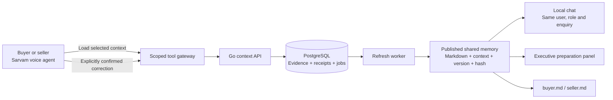

<div align="center">

# AuraLink
### One requirement. Shared memory. Every conversation.

**Context continuity for IndiaMART buyers and sellers across Sarvam voice and local chat.**


[Try the demo](#run-the-demo) · [How it works](#how-it-works) · [Verified journey](#verified-journey) · [Technical guides](#technical-guides)

</div>

---

## Why AuraLink?

A buyer updates a requirement during a call. Later, they open chat—or an executive prepares to contact them. Starting over loses time and can bring back outdated details.

AuraLink keeps one evidence-backed memory for each user and role. A confirmed correction updates the selected requirement, refreshes canonical `buyer.md` or `seller.md`, and becomes available to the next channel. Different customer enquiries stay separate.

> **The demo:** speak a correction to Vani in Sarvam, resume that exact requirement in chat, then see the same published details in the executive preparation panel.

## Verified journey

Actual Sarvam calls and local chat handoffs were rehearsed against synthetic data on 10 October 2026.

<details open>
<summary><strong>🛒 Buyer: voice remembers, chat continues</strong></summary>

1. Saved requirement: **Steel rods · 200 kg · Noida**.
2. Buyer confirms **450 kg** in a Sarvam voice call.
3. The backend publishes **memory v3**.
4. Chat resumes the actual voice session and recalls **Steel rods · 450 kg · Noida**.

The repeated identical voice request is idempotent: it does not create a second correction.

</details>

<details open>
<summary><strong>🏪 Seller: a customer enquiry follows the conversation</strong></summary>

1. Saved customer enquiry: **MCB · 100 pieces · Noida**.
2. Seller confirms a correction to **steel · quantity 500** in voice. The unit remains **pieces**, since it was not changed.
3. Chat resumes that enquiry using **memory v3**.
4. A reviewed chat correction changes quantity to **600**.
5. The next chat reply and preparation panel use **memory v4: steel · 600 pieces · Noida**.

Customer demand is kept separate from seller stock and delivery commitments.

</details>

These are synthetic rehearsals, not claims of real orders, independently verified demand, or production deployment. Local evidence copies are under `artifacts/submission/`; that private directory is intentionally excluded from Git.

## How it works



**Accept → refresh → publish → reuse.** Saving returns a receipt before publication. The worker validates corrections, publishes a new canonical snapshot and exports the files. New chat turns reject pending refresh rather than silently reading stale details.

- **Bound context:** sessions preserve tenant, namespace, user, role, channel and selected requirement.
- **Evidence-backed corrections:** each changed field cites its own prior event; multiple fields can change atomically.
- **Immutable history:** corrections supersede named fields without deleting earlier evidence.
- **Safe retries:** the same key and body return the original receipt; changed retry bodies conflict.
- **Verifiable memory:** chat and preparation expose the published version and SHA-256 hash.
- **Durable refresh:** PostgreSQL jobs, leases and bounded retries; no Kafka or RabbitMQ required.

## Run the demo

### 1 · Prepare local configuration

Use the Go toolchain declared in [go.mod](go.mod), a running PostgreSQL database and, for voice, Cloudflare Tunnel plus a Sarvam Voice Agents account. The PostgreSQL role must be able to create schemas for the isolated rehearsal.

From the repository root in PowerShell:

```powershell
Copy-Item .env.example .env
go mod download
```

Skip the copy if `.env` already exists. Set the six `PG*` values in your private `.env`; use your actual PostgreSQL port rather than assuming the example's port.

Set distinct random backend tokens for `DEMO_API_BEARER_TOKEN` and `SARVAM_TOOL_BEARER_TOKEN`. Generate each with:

```powershell
[Convert]::ToHexString([Security.Cryptography.RandomNumberGenerator]::GetBytes(32)).ToLower()
```

These backend tokens are separate from your Sarvam API key. Never commit `.env`, session capabilities or signed connection URLs.

<details>
<summary><strong>Which environment values are needed?</strong></summary>

- **Database:** `PGHOST`, `PGPORT`, `PGDATABASE`, `PGUSER`, `PGPASSWORD`, `PGSSLMODE`.
- **Backend access:** `DEMO_API_BEARER_TOKEN`, `SARVAM_TOOL_BEARER_TOKEN`.
- **Configured provider connection probe:** `SARVAM_VOICE_API_KEY`, `SARVAM_ORG_ID`, `SARVAM_WORKSPACE_ID`, buyer/seller app IDs and committed numeric versions.
- **Historical workspace:** `DEMO_SUBJECT_MANIFEST`, dataset paths and source-timezone configuration. A historical manifest must exist when using the normal private server; the synthetic command overrides its subject allowlist.
- **Model API:** `SARVAM_API_KEY` is not used by the deterministic local chat.

See [.env.example](.env.example). If an existing exported manifest is available, `go run ./cmd/apiconfig` can prepare missing backend tokens without printing them.

</details>

### 2 · Start an isolated buyer or seller rehearsal

```powershell
go run ./cmd/voice-demo -role buyer
# Or, in place of buyer:
# go run ./cmd/voice-demo -role seller
```

Open **[http://127.0.0.1:8091/demo](http://127.0.0.1:8091/demo)** and unlock with your local operator token (`DEMO_API_BEARER_TOKEN`).

The command starts the private UI/API on **8091**, the scoped voice gateway on **8083**, and the refresh worker. It creates a disposable PostgreSQL schema and writes session setup to ignored `artifacts/voice-demo/session.json`.

> Keep the process running. Restarting creates a fresh fixture, session and capability. The schema is removed on orderly shutdown; copy evidence before stopping. Buyer and seller rehearsals share ports, so run one at a time.

### 3 · Connect Sarvam voice

In a second terminal:

```powershell
cloudflared tunnel --url http://127.0.0.1:8083
```

Use the printed tunnel origin in your Sarvam agent's two API tools:

- **Load Memory:** POST `<tunnel-origin>/v1/sarvam/on-start`, on call start.
- **Record User Update:** POST `<tunnel-origin>/v1/sarvam/tools/record_user_update`, during the conversation.

Both require the service bearer (`SARVAM_TOOL_BEARER_TOKEN`) and `X-Auralink-Session-Token`. Bind `session_id` from the generated session file and map the ten Load Memory response variables. Keep capabilities outside the conversational context.

Session setup is manual in this rehearsal. Sessions expire after 30 minutes; refresh the session ID and both tool headers together. Tunnel restarts change the public origin, so update both URLs.

### 4 · Carry voice into chat

1. Make a call and explicitly confirm a correction.
2. In the demo UI, enter the call's session ID under **Continue an actual voice session**.
3. Click **Resume voice in chat**. The backend preserves the original subject, role and requirement.
4. Inspect the recalled facts, published version and preparation panel.
5. Try `quantity = 600`, review the proposal, and confirm it.

For a combined correction, use `product = steel; quantity = 500; unit = kg`. Chat saves only after review. Quantity must be one positive number; ranges are not supported.

## Implementation status

**Implemented and rehearsed:** buyer/seller voice memory recall and corrections, actual voice-session handoff to local chat, reviewed chat edits, canonical memory publication/export, and executive reuse of that same memory.

**Implemented with automated checks:** scoped authentication, idempotency, field-level correction ownership, atomic multi-field saves, refresh jobs, conflict handling, journals and memory hashes. Historical import/sample context covers three buyers and three sellers; the live voice journeys documented above demonstrate one synthetic subject per role.

**Still limited:** local chat is deterministic, not LLM dialogue or WhatsApp. Provider audio runs in Sarvam's UI; this repository does not host an audio client. Per-call secret binding is manual, free-text fact extraction is pending, and callback/on-end persistence is not implemented. Buyer v2 prompt changes were committed after the verified buyer call and still need a smoke test. There is no production freshness SLA or claim that all six subjects completed live calls.

## Verify the code

```powershell
go test ./...
go vet ./...
go build ./...
```

Optional PostgreSQL integration test, using disposable schemas:

```powershell
$env:AURALINK_RUN_DB_TESTS = '1'
go test ./internal/contextapi -run TestPostgresSessionBinding -count=1 -v
Remove-Item Env:AURALINK_RUN_DB_TESTS
```

Database checks require working local credentials and schema permissions. Unit tests and vet passed during development; repeat the integration check in your own environment.

Refresh status reports acceptance-to-publication and acceptance-to-file timings. Individual local observations are documented in [memory refresh](docs/memory-refresh.md); they are not provider latency or benchmark percentiles.

## Repository map

```text
cmd/                 Runnable server, gateway, rehearsal and verification tools
internal/contextapi/ Bound sessions, chat, updates and scoped provider tools
internal/memory/     Evidence reducer and canonical memory publication
internal/refresh/    Durable PostgreSQL refresh worker
internal/demoui/     Embedded chat and executive preparation UI
internal/sarvam/     Provider configuration and signed connection client
internal/ingestion/  Historical dataset ingestion and provenance
migrations/          Database schema migrations
docs/                Setup, API contracts and validation notes
```

## Technical guides

- [Local chat and shared memory](docs/local-chat-demo.md)
- [Sarvam buyer agent setup](docs/sarvam-buyer-agent.md)
- [Session update contract](docs/session-updates.md)
- [Atomic multi-field corrections](docs/multi-field-corrections.md)
- [Refresh worker and freshness measurements](docs/memory-refresh.md)

<details>
<summary><strong>Submission demo walkthrough</strong></summary>

1. Explain the repeated-context problem and show the selected synthetic requirement.
2. Make the Sarvam call, request a correction and explicitly confirm it.
3. Show the actual tool arguments and result without exposing credentials.
4. Resume the same session in chat and show the updated facts.
5. Confirm a chat edit and demonstrate the next reply using the new memory version.
6. Show the executive preparation panel and canonical Markdown/hash.
7. Close with the implementation limits and the measured local refresh timing.

Capture buyer and seller journeys separately. Preserve screenshots, canonical memory samples and private verification reports before stopping each disposable rehearsal. Never include the session setup file or `.env` in submission evidence.

</details>

---

<div align="center">

**Built for Voice AI Hackathon 2.0 · PS02: Global Context Memory Across Channels**

Go + PostgreSQL + Sarvam voice · Explicit confirmation · Shared, verifiable context

</div>
